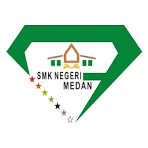
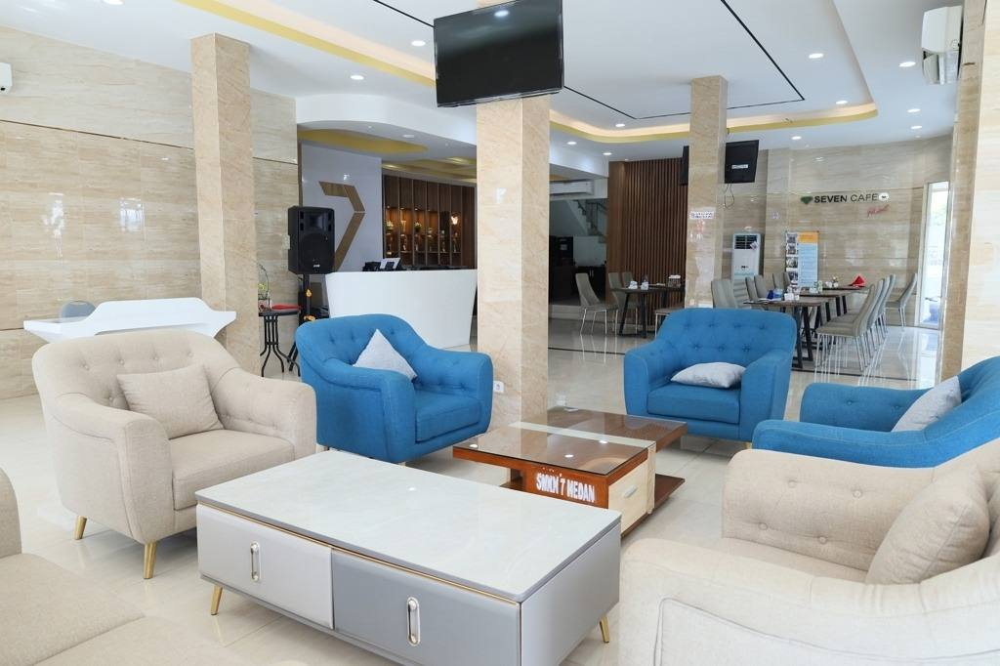

# Seven-Coffee
Website untuk pesan kopi
<!DOCTYPE html>
<html lang="id">
<head>
<meta charset="UTF-8">
<meta name="viewport" content="width=device-width, initial-scale=1">
<title>Seven Coffee — Katalog Kopi SMK Negeri 7 Medan</title>
<link href="https://fonts.googleapis.com/css2?family=Fraunces:opsz,wght@9..144,500;9..144,700;9..144,900&family=Plus+Jakarta+Sans:wght@400;500;600;700&display=swap" rel="stylesheet">
<link rel="stylesheet" href="css/style.css">
</head>
<body>

<svg width="0" height="0" style="position:absolute">
  <defs>
    <symbol id="wa" viewBox="0 0 24 24"><path fill="currentColor" d="M12.04 2C6.58 2 2.13 6.45 2.13 11.91c0 1.75.46 3.45 1.32 4.95L2.05 22l5.25-1.38a9.9 9.9 0 0 0 4.74 1.21c5.46 0 9.91-4.45 9.91-9.91S17.5 2 12.04 2Zm0 18.15c-1.48 0-2.93-.4-4.2-1.15l-.3-.18-3.12.82.83-3.04-.2-.31a8.2 8.2 0 0 1-1.26-4.38c0-4.54 3.7-8.24 8.25-8.24 4.54 0 8.24 3.7 8.24 8.24 0 4.55-3.7 8.24-8.24 8.24Zm4.52-6.16c-.25-.12-1.47-.72-1.69-.81-.23-.08-.39-.12-.56.13-.16.24-.64.81-.79.97-.14.17-.29.19-.54.06-.25-.12-1.05-.39-1.99-1.23-.74-.66-1.23-1.47-1.38-1.72-.14-.25-.02-.38.11-.5.11-.11.25-.29.37-.43.13-.15.17-.25.25-.42.08-.16.04-.31-.02-.43-.06-.12-.56-1.34-.76-1.84-.2-.48-.41-.42-.56-.43h-.48c-.17 0-.43.06-.66.31-.22.25-.86.85-.86 2.07 0 1.22.89 2.4 1.01 2.56.12.17 1.75 2.67 4.23 3.74.59.26 1.05.41 1.41.52.59.19 1.13.16 1.56.1.48-.07 1.47-.6 1.67-1.18.21-.58.21-1.07.15-1.18-.06-.1-.23-.16-.48-.29Z"/></symbol>
    <symbol id="crest" viewBox="0 0 120 140">
      <path d="M60 4 112 22v44c0 34-22 58-52 70C30 124 8 100 8 66V22L60 4Z" fill="#0f2a4a" stroke="#e3a72f" stroke-width="5"/>
      <path d="M60 16 100 30v36c0 27-17 46-40 56-23-10-40-29-40-56V30l40-14Z" fill="none" stroke="#e3a72f" stroke-width="1.5" opacity=".6"/>
      <text x="60" y="60" text-anchor="middle" font-family="Fraunces,serif" font-weight="900" font-size="44" fill="#e3a72f">7</text>
      <path d="M52 72c-2.5-3 2.5-5 0-8M60 72c-2.5-3 2.5-5 0-8M68 72c-2.5-3 2.5-5 0-8" fill="none" stroke="#f6efe4" stroke-width="1.8" stroke-linecap="round" opacity=".75"/>
      <path d="M40 75h40l-3.5 11a5 5 0 0 1-5 3.5H48.5a5 5 0 0 1-5-3.5L40 75Z" fill="#f6efe4"/>
      <path d="M80 77.5c5 0 5 7 0 7" fill="none" stroke="#f6efe4" stroke-width="2.6"/>
      <path id="arcC" d="M31 96 Q60 114 89 96" fill="none"/>
      <text font-family="Plus Jakarta Sans,sans-serif" font-weight="800" font-size="8.5" fill="#e3a72f" letter-spacing="2.2"><textPath href="#arcC" startOffset="50%" text-anchor="middle">COFFEE</textPath></text>
    </symbol>
  </defs>
</svg>

  

    

      
      
SMK Negeri 7 Medan<small>Teaching Factory</small>

    

    <button class="cartbtn" onclick="openCart()">Keranjang 0</button>
  

<header class="hero">
  

  

    

      ☕ Seven Coffee · SMK Negeri 7 Medan
      <h1>Kopi <em>Sanger</em> &amp; Kopi <em>Aren</em></h1>
      
Dua menu andalan Seven Coffee — diseduh dari espresso segar oleh siswa-siswi SMK Negeri 7 Medan. Pilih, atur, lalu pesan langsung lewat WhatsApp.

      
Semua menu <b>Rp 15.000</b> / gelas

      

        <a class="btn btn-gold" href="#menu">Lihat Menu</a>
        <a class="btn btn-wa" href="https://wa.me/6285358384078?text=Halo%20Seven%20Coffee%2C%20saya%20ingin%20bertanya%20tentang%20menu%20kopi." target="_blank" rel="noopener"><svg><use href="#wa"/></svg>Chat WhatsApp</a>
      

    

  

</header>

  ★ SEVEN COFFEESMK NEGERI 7 MEDAN★ ICE SANGER ESPRESSOICE AREN LATTE★ RP 15.000 / GELASPESAN VIA WHATSAPP
  ★ SEVEN COFFEESMK NEGERI 7 MEDAN★ ICE SANGER ESPRESSOICE AREN LATTE★ RP 15.000 / GELASPESAN VIA WHATSAPP

<section id="menu">
  

    Menu Kami
    <h2>Katalog Produk Kopi</h2>
    
Ketuk tab <b>Komposisi</b> untuk melihat takaran setiap bahan, atur pilihan Anda, lalu tekan <b>Pesan via WA</b>.

    

      <button class="chip on" data-f="all">Semua</button>
      <button class="chip" data-f="strong">Kopi Kuat</button>
      <button class="chip" data-f="milky">Lembut &amp; Susu</button>
    

    

  

</section>

<section style="padding-top:0">
  

    Cara Memesan
    <h2>Pesan dalam 3 langkah</h2>
    

      
<b>Pilih menu</b>
Tentukan Ice Sanger Espresso atau Ice Aren Latte (Rp 15.000/gelas), lalu atur level gula, es, dan jumlah.

      
<b>Isi data</b>
Tambahkan ke keranjang, lalu tulis nama dan kelas atau lokasi pengambilan.

      
<b>Kirim ke WhatsApp</b>
Pesanan otomatis tersusun rapi dan terkirim ke nomor +62 853-5838-4078.

    

  

</section>

<section class="school">
  

    

      Tentang Kami
      <h2>Seven CoffeeKopi seduhan Siswa SMK Negeri 7 Medan</h2>
      
Setiap gelas adalah hasil praktik nyata siswa — dari menakar espresso, mengocok krimer, hingga menyajikan ke pelanggan. Membeli kopi ini berarti ikut mendukung pembelajaran kewirausahaan di sekolah kami.

      

        
<b>Karya Siswa</b>
Diracik dan disajikan langsung oleh siswa.

        
<b>Takaran Tepat</b>
Setiap bahan ditakar sesuai resep standar.

        
<b>Espresso Segar</b>
Diekstrak saat dipesan, bukan disimpan.

        
<b>Wirausaha</b>
Belajar bisnis lewat produk yang nyata.

      

    

    <svg class="bigcrest" viewBox="0 0 120 140"><use href="#crest"/></svg>
  

</section>

<footer>
  

    

<b style="color:#fff">Seven Coffee · SMK Negeri 7 Medan</b> Produk Teaching Factory — Medan, Sumatera Utara

    
Pemesanan WhatsApp: <a href="https://wa.me/6285358384078" target="_blank" rel="noopener">+62 853-5838-4078</a>

  

</footer>

<a class="fab" href="https://wa.me/6285358384078" target="_blank" rel="noopener" aria-label="WhatsApp" style="color:#fff"><svg><use href="#wa"/></svg></a>

<aside class="drawer" id="drawer" aria-label="Keranjang">
  
<h3>Keranjang Pesanan</h3><button class="x" onclick="closeCart()" aria-label="Tutup">×</button>

  

    

    
<label for="nm">Nama pemesan</label><input id="nm" placeholder="mis. Rizky">

    
<label for="kl">Kelas / lokasi ambil</label><input id="kl" placeholder="mis. XI Tata Boga 1 / Kantin">

    
<label for="ct">Catatan (opsional)</label><textarea id="ct" rows="2" placeholder="mis. diambil jam istirahat"></textarea>

  

  

    
TotalRp 0

    <a class="btn btn-wa" id="sendAll" href="#" target="_blank" rel="noopener"><svg><use href="#wa"/></svg>Kirim Pesanan via WhatsApp</a>
    <small>Ke nomor +62 853-5838-4078 · pesan akan dibuka di WhatsApp</small>
  

</aside>

</body>
</html>
